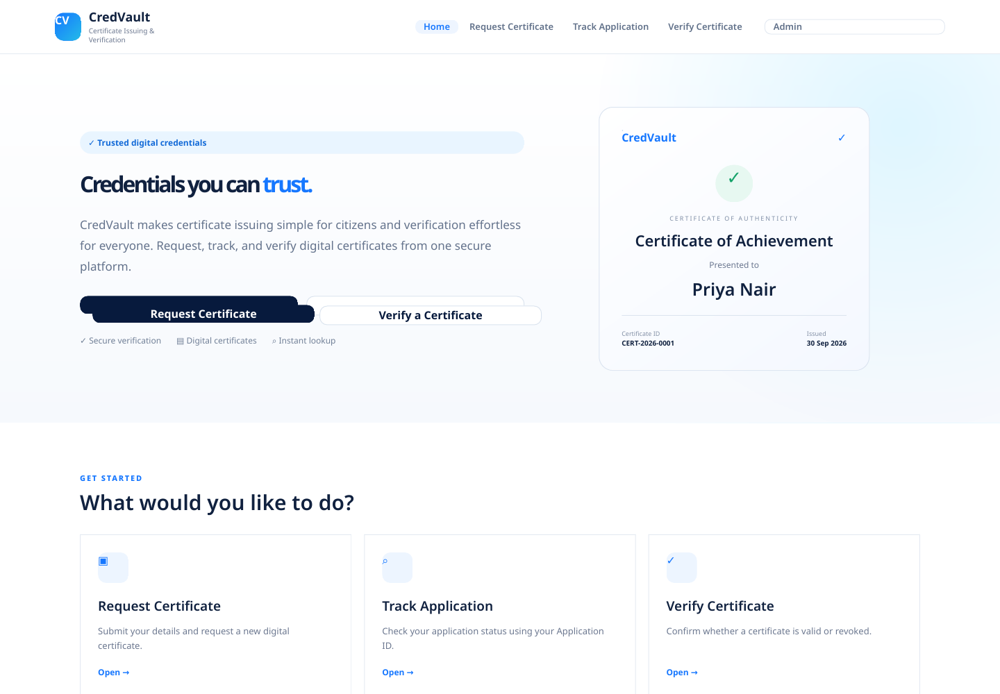
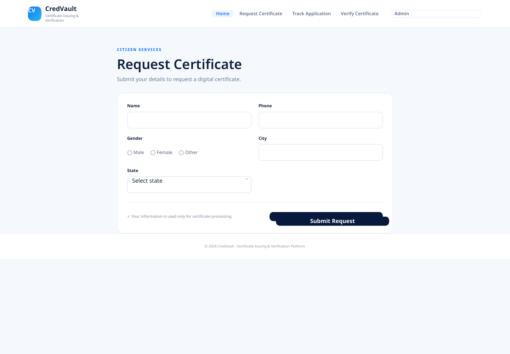
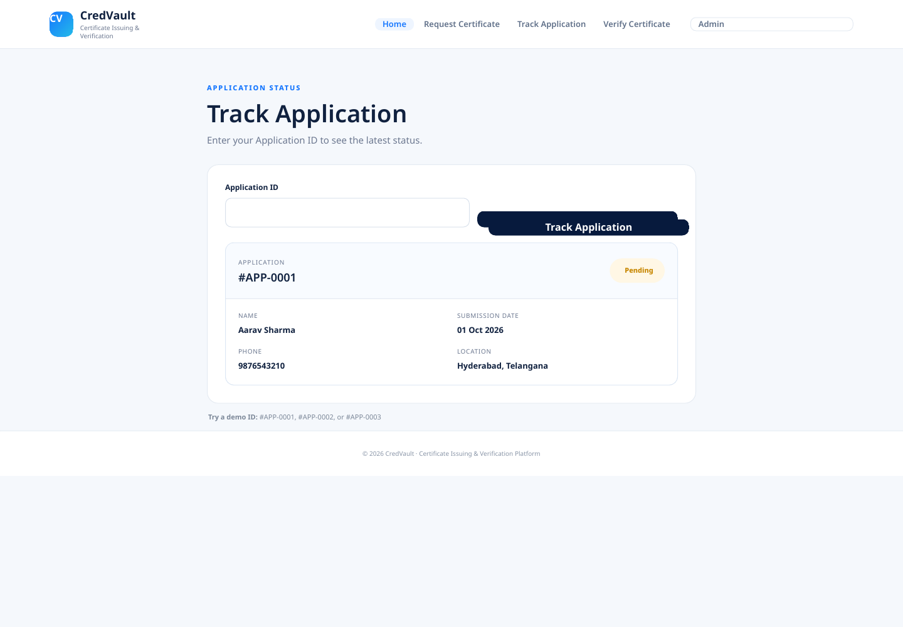
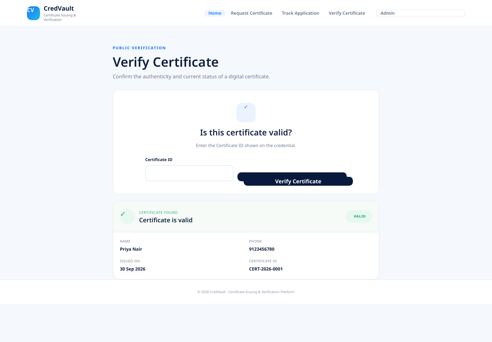
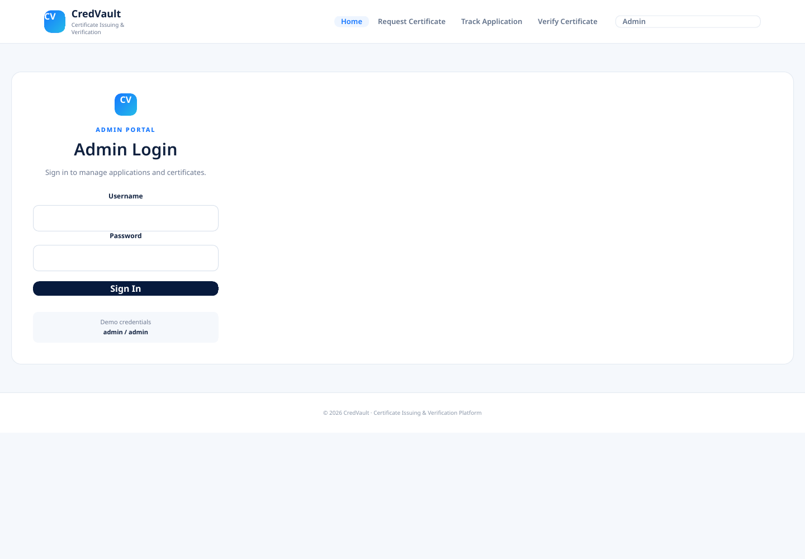
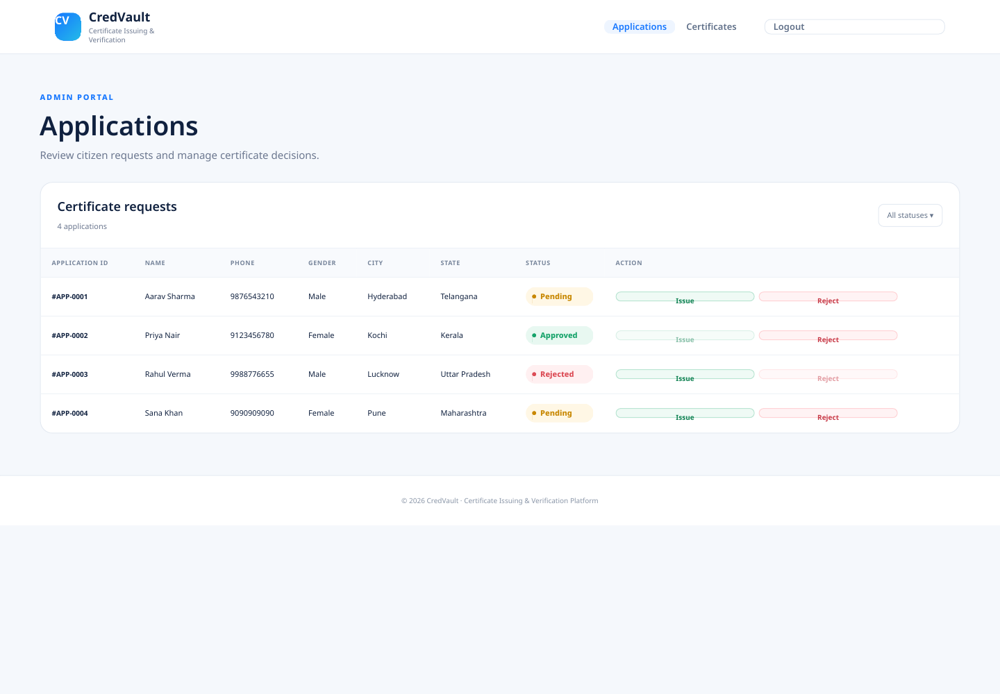
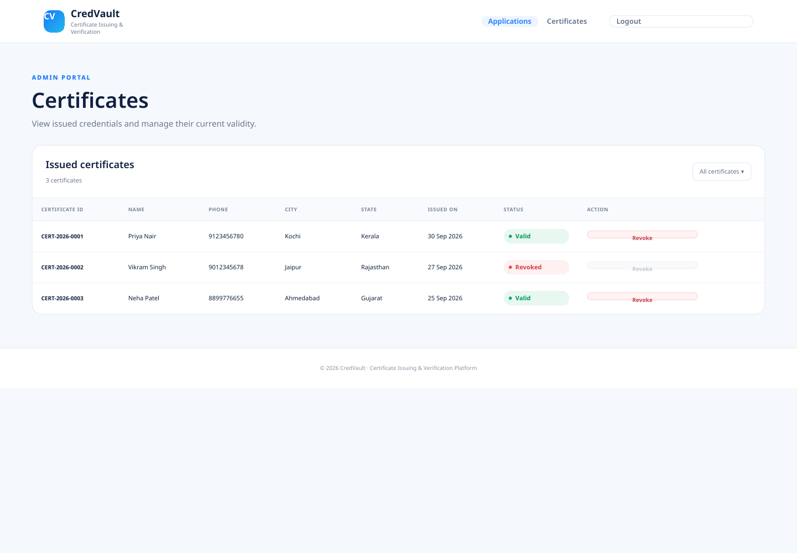

# ELEVATE-SDE-Task-2 — CredVault

A frontend-only prototype for **CredVault — Certificate Issuing & Verification Platform**, created for the ELEVATE SDE Internship Task 2.

## Scope

The SRS asks for citizen certificate requests, application tracking, public certificate verification, admin login, application management, and certificate management. This project uses dummy data only; no backend or database is required.

## Pages / Routes

- `/` — Home
- `/request` — Request Certificate
- `/track` — Track Application
- `/verify` — Verify Certificate
- `/admin/login` — Admin Login
- `/admin/applications` — Applications
- `/admin/certificates` — Certificates

## Demo credentials

**Username:** `admin`  
**Password:** `admin`

## Demo IDs

Applications: `#APP-0001`, `#APP-0002`, `#APP-0003`  
Certificates: `CERT-2026-0001`, `CERT-2026-0002`

## Tech

- HTML5
- CSS3
- Vanilla JavaScript
- Hash-based frontend navigation
- Dummy in-memory data

No backend, database, framework installation, or API is required.

## Run locally

From the project folder:

```bash
python3 -m http.server 4173
```

Open `http://localhost:4173`.

## Screenshots

### 1. Home Page


### 2. Request Certificate


### 3. Track Application


### 4. Verify Certificate


### 5. Admin Login


### 6. Applications


### 7. Certificates


## SRS checklist

- Certificate request form: Name, Phone, Gender, City, State
- All states included in the State dropdown
- Basic empty-field / phone validation
- Successful submission state with `#APP-0005`
- Application tracking with existing and not-found states
- Public certificate verification with existing and not-found states
- Admin login validated with `admin` / `admin`
- Applications table with Application ID, Name, Phone, Gender, City, State, Status and Issue/Reject actions
- Certificates table with Certificate ID, Name, Phone, City, State, Issued On, Status and Revoke action
- Dummy statuses: Pending / Approved / Rejected and Valid / Revoked
- Responsive, clean layout
- Frontend-only implementation ready for later backend integration

## Submission

Repository name required by the SRS: **ELEVATE-SDE-Task-2**
